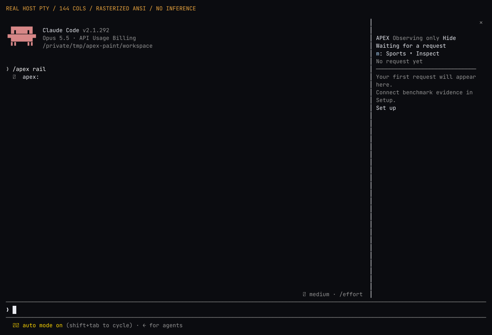
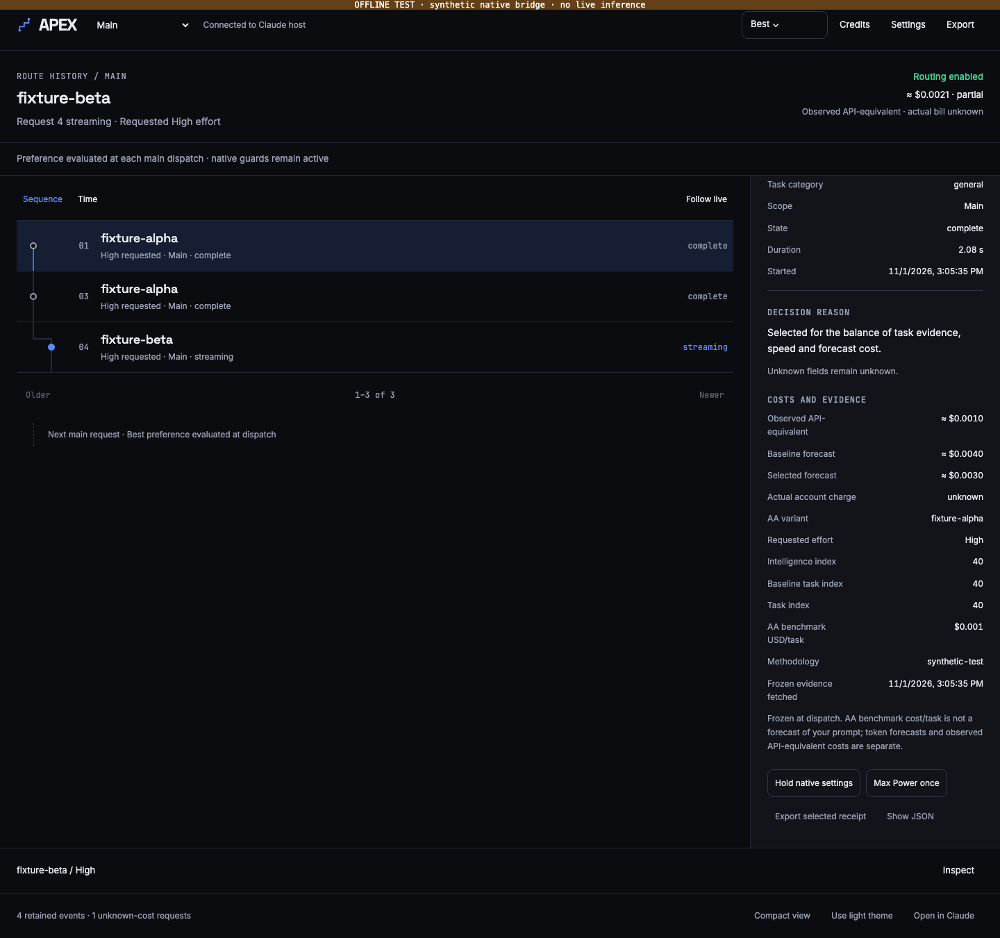

# APEX

**APEX by Zoran**

[](https://github.com/AdamNsouli/apex/actions/workflows/verify.yml)

**A native Claude Code mod that changes the model and effort on the next unsent main request, with a live timeline and evidence-backed routing.**

APEX is executable middleware, not just instructions to Claude. It wraps the official `turn.step` hook and forwards the selected model and effort while preserving the streamed response and conversation. Three modes (Save, Balanced and Best) can be selected while work is running.

**0.12.0-beta.1:** `/apex overhead` and an inspector section show what each chat re-reads before you type; a wiring check keeps every setting consistent across code, command, companion and web page. No routing change.

**0.11.1-beta.1:** only real failed checks (not searches with no match, refusals or browser errors) raise the tier, and gradually; see the changelog.

**0.11.0-beta.1:** specified implementation is separate from unresolved judgment. A concrete coding contract with file/spec references and corroborating acceptance/preservation instructions uses the ordinary implementation tier while retaining its risk label. It escalates after a failed check and again after repeated failures. Length or a path alone is insufficient; unresolved design/debugging stays protected. Balanced and Save no longer auto-enable Ultracode or inject a parallel-agent nudge. Verified workflow mapping labels get their own implementation budget; unknown workers and reviewers keep the parent demands. This is routing-policy verification, not a measured claim of equal task quality or subscription savings.

**0.10.0-beta.1:** three modes instead of six: Save, Balanced and Best. All use Balanced's rule (good enough for the task, no long wait, most score for the usage) and differ only in how much a better answer is worth, so none of them gives an 11-minute or far-too-weak answer to an ordinary prompt. Ultracode and parallel subagents follow the size of the task: Best for hard and critical tasks, Balanced for critical ones, Save never. Max Power once stays for a single strongest answer. Saved modes carry over.

**0.9.0-beta.1:** six modes, each doing what its name says: Balanced (the 0.8 value rule), Cost Efficient (cheapest pair good enough), Time Efficient (fastest pair good enough at no more than 3x what Balanced would pay), Max Power (strongest), Max Speed (fastest over a low floor, cost ignored) and Max Power + Speed (fastest within 95% of the strongest). The two speed modes use ultracode for hard and critical tasks, route subagents as quick tasks, and ask Claude to split fresh tasks across parallel subagents. Critical tasks keep their full floor in every mode. Old saved modes carry over (Eco → Cost Efficient, High Quality → Max Power, Sports → Time Efficient).

**0.8.0-beta.1:** APEX picks on value, not on "nearly as good as the top model". Every model at every effort is weighed on the benchmark for the kind of task (coding, agentic work, reasoning, knowledge, a sector or general), and the pick is the most score for the usage among pairs that are good enough and quick enough. Ordinary prompts no longer default to Opus at high effort, agentic work often goes to Sonnet, and money, legal and admissions questions are held to the critical tier in every mode. Checked offline with a 200-prompt replay; see the changelog.

**0.7.1-beta.1:** the publisher line reads "APEX by Zoran"; routing is unchanged.

**0.7.0-beta.1:** APEX now moves between models, not only efforts. Before, it only considered models with exactly the same thinking flags as the one the chat started on, so Haiku, Sonnet and Opus never replaced each other; a chat that started on an effort the benchmarks do not name was not routed at all; and risky prompts could not go below the starting pair. Now every confirmed model is a candidate, a move to another model is made when it repays re-storing the conversation over the next five requests, and subagents are routed too (`/apex agents off` turns that off). A replay of 200 labelled prompts (`scripts/replay.mjs`) measures each change offline. Checked offline and in CI.

**0.6.0-beta.1:** ultracode now follows the mode instead of a separate opt-in: Sports uses it for hard and critical tasks, High Quality for critical tasks, Balanced and Eco never. `/apex ultracode off` rules it out everywhere. Checked offline and in CI.

**0.5.0-beta.1:** APEX can turn ultracode (Claude Code's multi-agent mode) on for a critical task and off again when that turn ends. It is off by default and enabled with `/apex ultracode auto`, because it uses far more than a normal request. Checked offline and in CI, and the hold, switch-on, send and switch-off sequence was run once in a live session; a real multi-agent run under it has not been observed.

**0.4.0-beta.1:** routing now follows a data-driven policy and configures itself from the daily benchmark refresh. For each task APEX picks the cheapest model/effort pair that reaches enough of the strongest comparable score within a wait limit, using AA's measured cost per task, so a high effort that burns more tokens costs more. Effort variants of confirmed models join automatically, the refresh records what changed, and `/apex confirm-models` adds a newly discovered model. Checked offline and in CI; live inference and real-key AA ingestion are still unverified.

**0.3.0-beta.2:** reliability fixes. Fallback-benchmark efforts can be confirmed (`/apex map-efforts`), open chats no longer overwrite each other's saved settings, and a failed or signed-out model discovery no longer blocks the next one for a day. No change to the interface or routing policy. Checked offline and in CI; live inference, billing and measured savings remain unverified.

**0.3.0-beta.1:** premium native rail and route workspace. Native hook tests, local browser integration and genuine terminal rendering checks pass. Live Anthropic inference, authenticated Artificial Analysis data ingestion and account billing have not been verified. There is no claim of guaranteed optimal routing or guaranteed bill savings.

## Tell Claude to install it

Copy this into **Claude Code**:

> Install APEX from the GitHub repository AdamNsouli/apex. Read its README and INSTALL.md first. Check that Claude Code is at least 2.1.292 and Node.js is at least 22; explain any prerequisite update before changing my installation. Add the apex-tools marketplace from AdamNsouli/apex and install apex@apex-tools at user scope. Reload plugins using the supported command or explain if a restart is needed, then open /apex rail and run /apex doctor. Help me connect my own Artificial Analysis API key using the local dashboard, and confirm the models my account permits and their exact benchmark/effort mappings. Do not read or copy my Claude login credentials, buy credits, change account billing, or run paid inference as an installation test. Report which checks succeeded and any remaining setup.

Or run:

```sh
claude plugin marketplace add AdamNsouli/apex
claude plugin install apex@apex-tools --scope user
```

Then reload plugins or restart Claude Code. The terminal prompt dock appears automatically. Open `/apex rail` for the compact native rail and `/apex dashboard` for the optional browser console. **A bare name is not globally resolvable: include `AdamNsouli/apex` when asking Claude to install.** No npm install is needed to use the plugin.

See [INSTALL.md](INSTALL.md) for the complete setup and removal instructions.

## What it does

- Routes actual main requests through the official model/effort hook; does not rewrite your transcript or replay tools.
- Shows request and tool activity, original settings, APEX-requested settings, response-reported model, revision, selection reason, and token-cost receipts. Requested effort is shown explicitly; effective provider effort stays unknown.
- Accepts live mode changes through native buttons, slash commands or an authenticated loopback dashboard. An already streaming request stays on its existing settings; acknowledged changes apply to the next unsent request.
- Discovers model IDs, efforts and capabilities from Anthropic's Models API; gets indices, prices, benchmark USD/task and performance from **your own Artificial Analysis key**. No generation-specific list or copied public benchmark dataset is bundled.
- Chooses by policy, not from a fixed list: among pairs that reach the task's floor within its wait limit, the one with the most score for the usage (score minus cost divided by what a point is worth for that task). No model name is built in, so a new model or changed benchmark numbers change the choice at the next daily refresh. Effort variants of confirmed models join automatically. A newly discovered model waits for your confirmation (`/apex confirm-models`) because APEX cannot tell whether your plan includes it.
- Compares general intelligence, coding, agentic coding and six domain indices. A local deterministic classifier selects a broad task category; it does not send your prompt to a separate classifier model. Math uses the general intelligence index as a proxy.
- Keeps the native model when access, identity mapping, effort, capabilities, context size or freshness is unknown. New model discovery does not silently grant account access.
- Respects user model/effort overrides through manual hold. Subagents are routed under the base mode (search agents as quick tasks); an agent given its own model keeps it, and `/apex agents off` leaves all agents alone.
- Requires explicit APEX consent before changing requests on a confirmed direct-API backend. Consent is reset when a session starts or clears. Estimated reservations and unknown-cost liabilities protect APEX's routing budget; native requests are not stopped when that budget is exhausted.

## Live modes

For each request APEX classifies the task locally into a kind (coding, agentic work through files and tools, reasoning, knowledge, a business sector, or general) and a tier, then scores every confirmed model at every effort on that kind's benchmark. Pairs below the tier's floor (a share of the strongest score) or slower than its wait limit are dropped; of the rest it takes the highest value, `score − cost per task ÷ worth of a point`. A quick task values a point at 3 cents, so a slightly weaker pair for a fraction of the usage wins; a critical one at $1.20, so the stronger pair wins unless it is far dearer. A higher effort on a smaller model and a lower effort on a bigger one compete on the same terms. Cost is AA's measured benchmark USD per task, so an effort that burns more tokens costs more. Nothing here names a model.

Since AA's index v5 its free API no longer fills the coding and agentic indices, so those, reasoning (HLE-Diamond, CritPt) and knowledge (AA-Omniscience) come from a dated snapshot of AA's public model pages in `core/task-scores.mjs` (refresh with `node scripts/refresh-task-scores.mjs`). Coding is Terminal-Bench 4.0 with FrontierCode 2.0; agentic work is AutomationBench with Terminal-Bench 4.0. The snapshot is ignored once AA's index version changes.

| Tier     | When                                                                       | Floor (share of best) | Worth of a point | Wait limit |
| -------- | -------------------------------------------------------------------------- | --------------------- | ---------------- | ---------- |
| Quick    | simple, low-risk requests                                                  | 40%                   | $0.03            | 30 s       |
| Everyday | ordinary requests                                                          | 60%                   | $0.15            | 60 s       |
| Hard     | complex requests                                                           | 80%                   | $0.40            | 150 s      |
| Critical | high-risk (money, legal, admissions, production, security) or failed twice | 90%                   | $1.20            | 300 s      |

| Mode (`/apex mode …`) | What it is for                        | How it differs from Balanced                                       |
| --------------------- | ------------------------------------- | ------------------------------------------------------------------ |
| Save (`save`)         | when your usage limit is close        | a point of score is worth 70%, so it settles for cheaper pairs     |
| Balanced (`balanced`) | almost everything                     | the tiers above                                                    |
| Best (`best`)         | exams, university, money, launch work | a point is worth 6×, the floor is 10 points higher, waits up to 2× |

All three use the same rule: drop pairs under the tier's floor or over its wait limit, then take the most score for the usage. So no mode ever hands an ordinary prompt a five-minute answer or a model far too weak for it. A critical task keeps at least Balanced's floor and point worth in Save. **Max Power once** (`/apex quality-once`, or the button) sends one prompt to the strongest pair whatever it costs or takes, then goes back to your mode. Names from earlier versions still work and carry over: eco and Cost Efficient become Save; quality, Max Power and Max Power + Speed become Best; sports, Time Efficient and Max Speed become Balanced. An unknown saved mode becomes Balanced.

**Subagents.** Search agents are always routed as quick tasks. Positively identified workflow mapping/search workers use the ordinary implementation tier; reviewers, architects and unknown workers retain the parent risk/difficulty without inheriting its specified-execution tag. In Save, other non-critical workers use the quick tier unless their parent is specified. Explicit worker models remain respected. Only in Best (or Max Power once), for the big tasks that qualify for ultracode (below), if ultracode is off or cannot be used, APEX attaches a short note, read by Claude and not shown to you, asking it to split independent parts across parallel subagents. It is never sent in Balanced/Save, with continuations, slash commands, messages typed over a running turn, or with `/apex agents off`. A specified task in Balanced/Save instead receives a single-main-agent execution note; this guides Claude but does not hard-disable its native tools.

On 200 of the maintainer's labelled prompts with the 30 Oct data, starting on Opus 5.5 high (benchmark cost per AA task; real prompts are smaller, so compare modes, not bills): always Opus high $3.52 and 37 s; Save $2.58, typically 15 s, 43 of 200 below their labelled need; Balanced $2.96, 19 s, 14 of 200; Best $5.39, 37 s, 8 of 200; Max Power once $10.30, about 11 minutes, 0 of 200.

These are transparent heuristics, not measured task-success probabilities, and the shares and wait limits are judgment calls. The wait limit compares AA's median end-to-end seconds, not your prompt. Routing is not held at the model the chat started on: unresolved high-risk or twice-failing tasks use the critical tier, complex ones use hard, and concretely specified implementation uses everyday until a failure promotes it to hard. Moving to a different model pays one cache write for the whole conversation, so it is made only when it repays that over the next five requests, counting both usage and score (Max Power once needs a higher score), or when no effort of the current model reaches the task's floor. A change of effort alone keeps the cache and needs no payback. With benchmark data older than three days nothing goes below the starting pair. If a task has no index for every compared pair, general intelligence is used for all of them and the receipt says so. If the benchmark data has no cost-per-task figures, native settings are kept.

## Ultracode for the hardest tasks

Ultracode is Claude Code's multi-agent mode. It is a session switch, not a field of a request, so APEX cannot set it the way it sets model and effort. It follows the size of the task within your mode:

| Mode                 | Ultracode               |
| -------------------- | ----------------------- |
| Best, Max Power once | hard and critical tasks |
| Balanced             | never automatically     |
| Save                 | never                   |

A qualifying task typed at an idle prompt is held for a moment: APEX runs `/effort ultracode on`, sends your message as your own words, and runs `/effort ultracode off` when that turn ends. Everything else is sent as typed: ordinary tasks, continuations such as "yes", slash commands, messages with attachments, and messages typed over a running turn. Held routing and pins leave it alone. If a session ends while it is on, the next session start turns it off. Ultracode uses far more than a normal request and has no benchmark, so these tiers are a judgment call; `/apex ultracode off` rules it out in every mode, and `/apex ultracode auto` restores the table.

## Interface

`/apex rail` opens the **compact native rail**: current pair, last three main requests, one mode selector and Inspect. It requests 34 body columns; Claude chooses docking, inline placement and height. A wide terminal places it beside the conversation. A narrow terminal places it above the composer. Hide it and reopen with `/apex`; no browser is required.



This is actual Claude Code 2.1.292 ANSI output converted to an image, with local font rendering. No inference or real benchmark data is shown. [Narrow terminal](docs/screenshots/native-terminal-inline.png) · [Acknowledged pending mode](docs/screenshots/native-terminal-inline-pending.png).

The **prompt strip** is the two-row fallback. Its expanded, compact or hidden preference is saved locally. It yields to native surveys, preserves other mods, and suppresses duplicate controls while the rail is docked. Focus it with Claude's `ctrl+x tab`; `m` opens modes and `i` opens the rail. The mode chooser uses `b`, `c`, `t`, `p`, `s`, `x` (Balanced, Cost, Time, Power, Speed, Power + Speed) while its site has focus. Host fonts, button chrome, scrolling and focus remain native. Desktop panes have harness coverage; live desktop rendering is unverified.

**Inspect** puts history, the selected receipt and its frozen evidence together. Selection stays on the historical request until you choose Follow live. Settings, consent and catalogue comparisons open contextually. Main and observed agent scopes remain distinct; agent receipts show how each agent was routed.

The optional **browser workspace** has one command bar, stepped request history and a narrow inspector. A step means an actual outgoing model/effort change. Tool markers mean recorded tool activity. Time view plots only known start/completion timestamps. Complete retained history is paginated, not silently hidden; theme and compact-view preferences persist locally.



[Compact workspace](docs/screenshots/dashboard-compact.png) · [Evidence setup](docs/screenshots/model-evidence.png) · [Mobile light theme](docs/screenshots/dashboard-mobile-light.png). Browser pictures use synthetic fixtures, not measured model results. [Native interface contract](docs/Native_Interface.md) · [UI specification](docs/UI_Specification.md) · [Assets and licenses](docs/Asset_Inventory.md).

**Max Power once** arms Max Power for the next main dispatch, then returns to your base mode. It does not replay a request or bypass safeguards. Agents cannot consume it. Cancellation is explicit; restart or clear cancels the arm. If a guard holds native settings, the arm is still consumed and the receipt records why.

## Credits and costs

**Credits → Allow within estimate budget** grants APEX routing consent within an API-equivalent estimate budget. It does not activate Claude account extra usage or buy credits. The dialog provides the native `/usage-credits` command to manage account billing yourself. Actual billed charges and subscription entitlement remain **unknown**.

AA's benchmark `cost_per_task` is displayed separately from the forecast for your request. Token prices and benchmark latency do not guarantee your provider's price, cache behavior or response time. Unknown cache prices produce unknown observed costs; APEX retains the request's reservation instead of treating that charge as zero. The budget limits APEX's routing decisions, not all Claude spending.

## Data, privacy and limitations

Artificial Analysis publishes broad task indices, not a forecast of success on every individual prompt. Exact model-version and effort mappings need verification when identifiers differ. The dashboard supports that confirmation. Model access is also confirmed by you: the API list alone does not establish subscription access.

Catalogues refresh at most once per day while the session is open. Partial refreshes retain the prior snapshot. After 72 hours, automatic quality downgrades stop; after seven days, switching stops. Closed sessions do not run a background monitoring service.

Your AA key is held in local companion memory or supplied via `APEX_AA_API_KEY`. Native login authorization uses Claude's opaque handle only for first-party model discovery. APEX does not export the login token. Native local store holds routing preferences, the dock display preference and normalized benchmark cache. Receipts are session-only, capped at 1,000 events; export before closing. No transcript, tool arguments, paths or private reasoning are kept in receipts. Your normal Claude provider still receives the normal conversation.

This public repository contains code and synthetic fixtures, not an AA dataset. Use a key and license appropriate to your use. A hosted/shared redistribution service needs its own authorization from AA.

## Development and verification

```sh
npm run check
npm test
claude plugin validate plugins/apex
claude plugin validate .
npm run test:native
```

Browser testing additionally needs the development-only Playwright package and its Chromium binary:

```sh
npm install --no-save playwright@1.62.1
npx playwright install chromium
npm run test:browser
```

The installed plugin has no package dependencies. See [Verification_And_Limits.md](docs/Verification_And_Limits.md), [Architecture.md](docs/Architecture.md), [Routing_Policy.md](docs/Routing_Policy.md), and [SECURITY.md](SECURITY.md).

MIT license covers APEX code and original assets. Bundled fonts retain their SIL Open Font License notices in the asset inventory. External services and data keep their own terms. APEX is an independent project, not an Anthropic or Artificial Analysis product.
